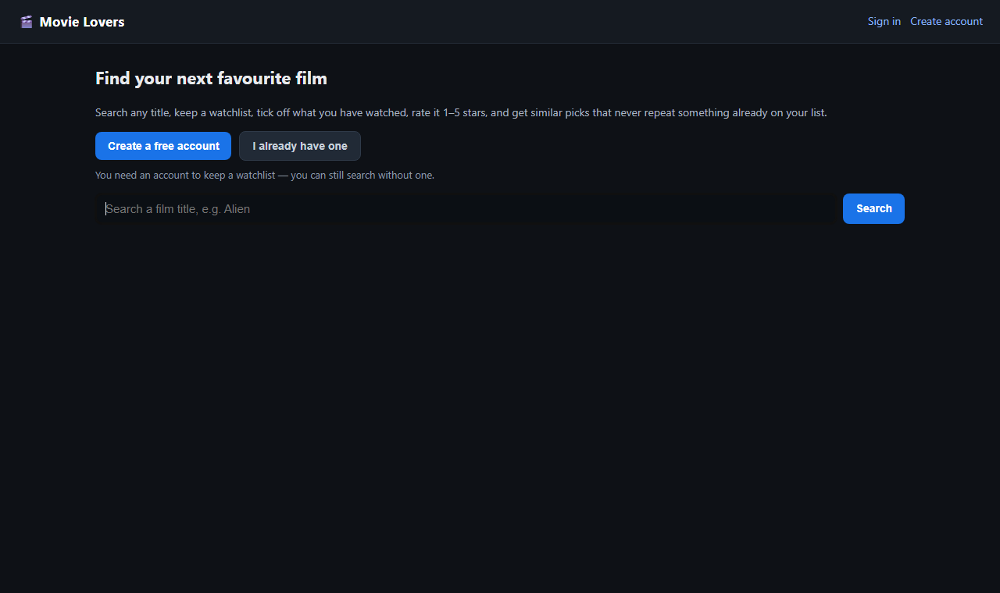
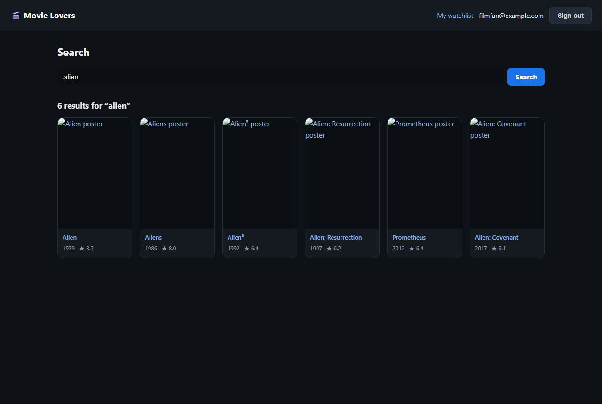
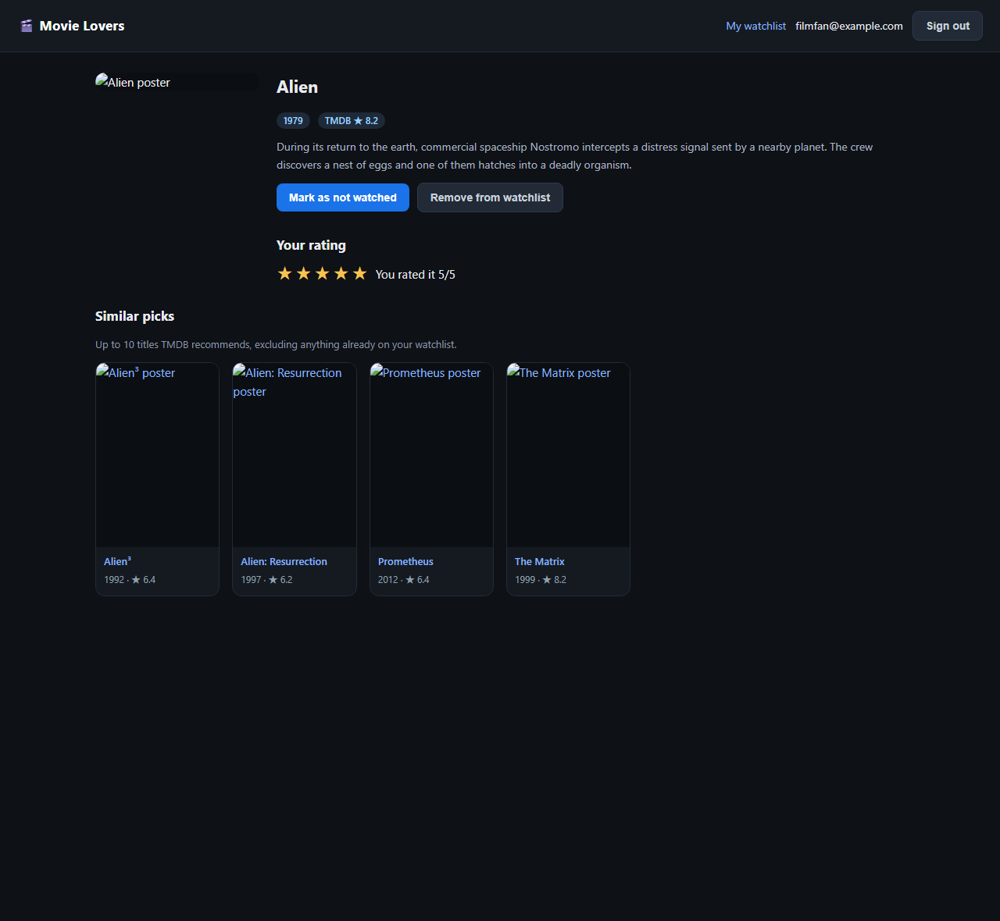
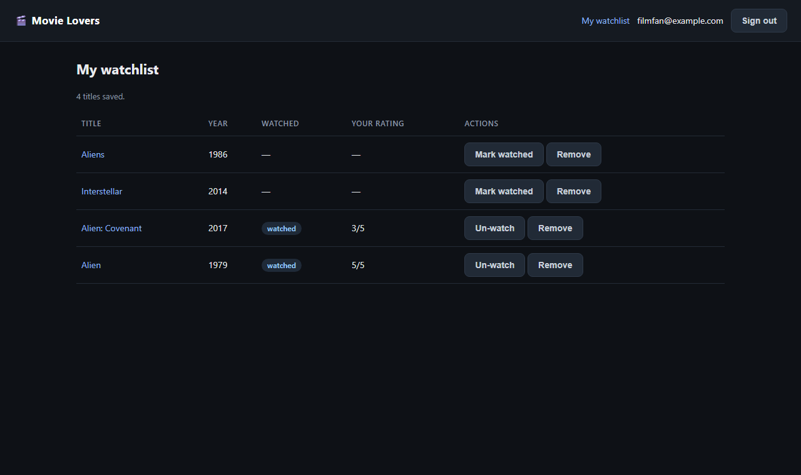
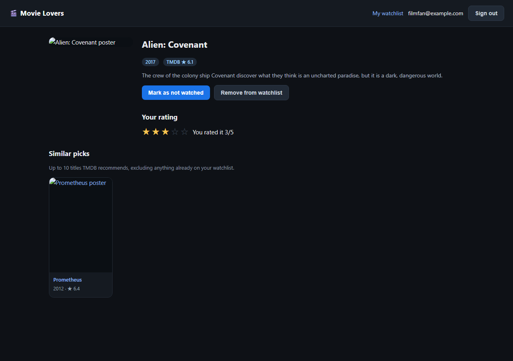
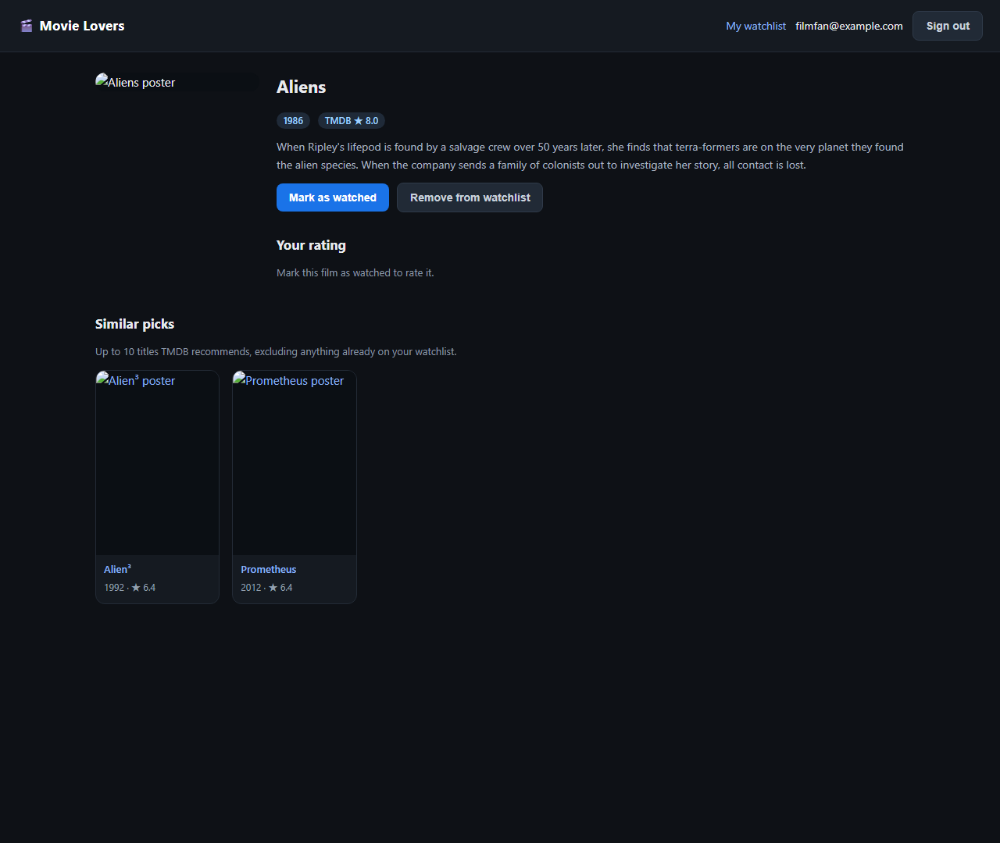

# USER GUIDE - for the film fan, not the programmer

Movie Lovers is a small website that helps you answer three questions: *what
should I watch next, what have I already seen, and was it any good?*

You do not need to install anything to use it - whoever set it up for you has
already done that. Just open the address they gave you (it usually looks like
`http://127.0.0.1:8000`) in your browser.

---

## 1. Make an account (one minute)

The first screen has two buttons. Pick **Create a free account**.

Type your email and a password of at least 8 characters. There is no
confirmation email - your account works immediately. Next time, use
**I already have one** instead.

You can search without an account. You just cannot save anything.

---

## 2. Search for a film

Type part of a title into the search box - `alien`, `matrix`, `interstellar` -
and press **Search**. You get a grid of results, each with its poster, title,
year, and the average score TMDB gives it (out of 10).

Click any poster or title to open that film's page.

> Tip: shorter is better. `alien` finds six films; `Alien 3 special edition` may
> find nothing.

---

## 3. Keep a watchlist

On a film's page, press **Add to watchlist**. That is your "I want to see this"
pile.

Everything you save is under **My watchlist** in the top bar. From there you can
remove anything you have gone off, or tick it off once you have seen it.

The list shows each film's year, whether you have watched it, and your own
rating if you gave one. **Remove** deletes it - including your rating, so decide
before you press it.

---

## 4. Tick off what you have watched

Once you have actually seen a film, press **Mark as watched**.

This matters for two reasons: it is the only way the app can tell "want to see"
from "have seen", and **you can only rate a film after marking it watched**.
That is deliberate - ratings from people who have not seen the film are noise.

Pressed it by mistake? The button turns into **Mark as not watched**; press it
to undo - but note that unticking it also clears your star rating for that film.
"Not watched, but rated 5" is a contradiction the app refuses to store, so the
tick and the stars stand or fall together.

---

## 5. Rate it, 1 to 5 stars

When a film is marked watched, five stars appear under **Your rating**.

Click the third star for "good", the fifth for "a favourite". The stars fill in
and the line underneath says what you gave it. Changed your mind after sleeping
on it? Click a different star - your rating is replaced, not added, so a film
never ends up with two ratings from you.

One star means "not for me", five means "watch it tonight".

---

## 6. Find something similar

Scroll down on any film page to **Similar picks**: up to ten other films that
TMDB considers alike.

The important part: **anything already on your watchlist is left out.** The
point is to show you films you have not thought of, not to show you your own
list back. If you have saved most of what relates to a film, the section shrinks
- that is the filter working, not a bug.

If everything TMDB suggests is already saved, you will see a note saying there
is nothing to suggest.

---

## 7. Signing out

**Sign out** in the top bar. Your watchlist is waiting when you come back.

---

## Questions you might have

**Is my watchlist private?**
Yes, in the sense that it is tied to your account: another account on the same
site sees its own list only, never yours.

**Did the app remember what I searched?**
No. Your watchlist and ratings are saved, your search terms are not.

**What does the "TMDB" star number mean?**
It is the average score from thousands of TMDB users, out of 10. Your own stars
are separate and out of 5 - do not compare the two.

**I forgot my password.**
There is no reset yet. Ask whoever runs the site to remove your account so you
can make a fresh one.

**Can I use it on my phone?**
The layout adapts to a narrow screen, but this is a local feature - it is not on
the public internet, and there is no mobile app.
